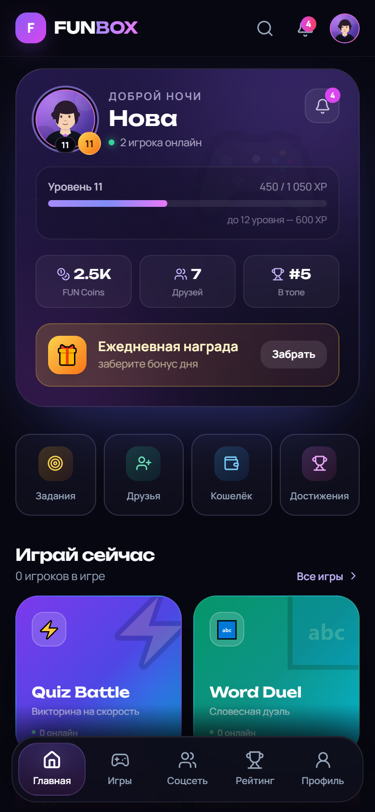
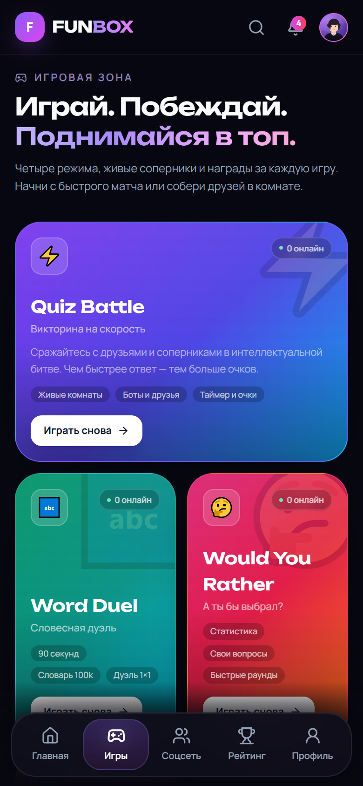
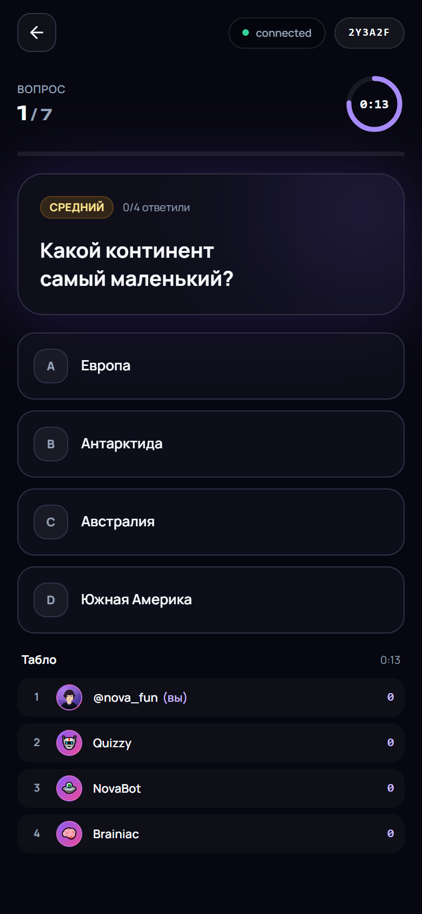
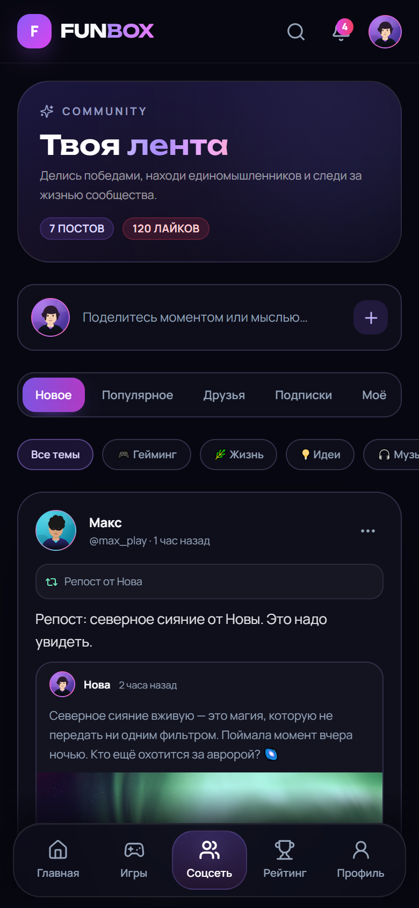
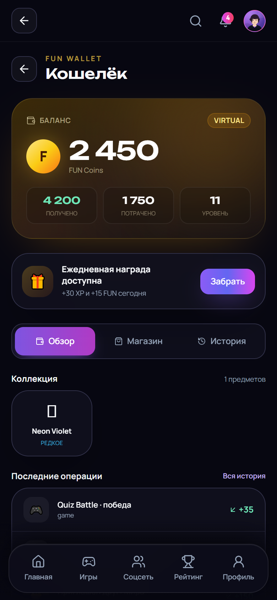
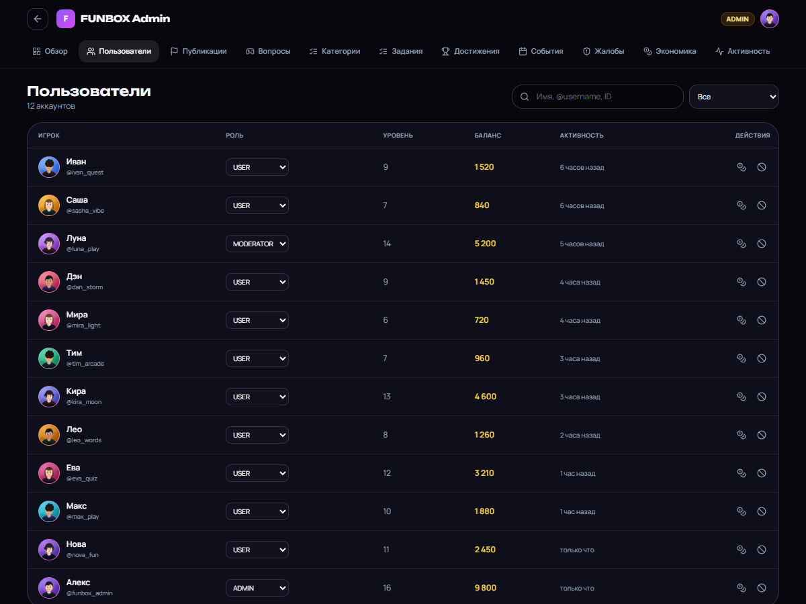

# 🎮 FUNBOX — Telegram Entertainment Ecosystem

**FUNBOX** — полноценная развлекательная платформа внутри Telegram: Mini App, Telegram-бот, backend на Express + Prisma + PostgreSQL, real-time игры через Socket.IO, социальная сеть, чат, задания, достижения, экономика и административная панель.

> FUN Coins — виртуальная игровая валюта. Она не имеет денежной стоимости, не продаётся за реальные деньги и не подлежит выводу.

| Home | Games |
|---|---|
|  |  |

| Quiz Battle | Social feed |
|---|---|
|  |  |

| Wallet | Admin panel |
|---|---|
|  |  |

---

## Содержание

- [Что реализовано](#что-реализовано)
- [Стек](#стек)
- [Структура проекта](#структура-проекта)
- [Быстрый старт (локально)](#быстрый-старт-локально)
- [Подключение Telegram-бота](#подключение-telegram-бота)
- [Docker / production](#docker--production)
- [Переменные окружения](#переменные-окружения)
- [Игры и real-time](#игры-и-real-time)
- [Безопасность](#безопасность)
- [Администрирование](#администрирование)
- [Тесты и проверка](#тесты-и-проверка)
- [Документация API](#документация-api)
- [Демо-данные](#демо-данные)
- [Ограничения и масштабирование](#ограничения-и-масштабирование)

---

## Что реализовано

### Telegram Mini App

- Premium dark UI с glassmorphism, градиентами, Framer Motion, нижней навигацией и safe-area.
- Светлая и тёмная темы, Telegram theme parameters, haptic feedback, нативная кнопка «Назад».
- Home dashboard: уровень/XP, баланс, друзья, статистика, игры, события, задания, рейтинг, рекомендации.
- 4 игры с собственной логикой и сохранением результатов.
- Социальная лента: посты, фото, лайки, комментарии, репосты, темы, подписки, жалобы и блокировки.
- Поиск по игрокам, публикациям, играм и темам.
- Друзья: поиск, заявки, принятие/отклонение, приглашения по Telegram-ссылке, личные сообщения.
- Чат в реальном времени: текст, фото, эмодзи, индикатор набора, статусы прочтения.
- Профиль с редактированием, приватностью, достижениями, статистикой и последними публикациями.
- Рейтинги по игрокам, победам, XP, активности и популярности; фильтры «сегодня / неделя / месяц / всё время».
- Задания daily/weekly/onboarding/special, прогресс, награды и защита от повторного получения.
- Кошелёк: баланс, история транзакций, ежедневный бонус, магазин косметики, коллекция.
- Достижения с редкостью, прогрессом коллекции и наградами.
- Skeleton loading, empty states, toast-уведомления, обработка ошибок.
- Demo-режим для запуска в обычном браузере без Telegram.

### Telegram-бот (Telegraf)

- `/start`, `/profile`, `/games`, `/rating`, `/daily`, `/help`, `/settings`.
- Красивое приветствие с inline-кнопками и открытием Mini App.
- Реферальные ссылки, бонус за приглашение.
- Настройки уведомлений (друзья, сообщения, достижения, daily, игровые приглашения).
- Ежедневные напоминания после 18:00 МСК.
- Push-уведомления через Bot API о достижениях, заявках, сообщениях и приглашениях в комнаты.
- Защищённый внутренний API бота через `x-bot-secret`.

### Backend

- Express + TypeScript, модульная структура.
- Prisma ORM + PostgreSQL, 39 таблиц, связи, индексы, enum-ы, уникальные ограничения.
- Проверка Telegram `initData` (HMAC-SHA256 + constant-time compare + TTL).
- JWT-сессии, RBAC (`USER`, `MODERATOR`, `ADMIN`).
- Socket.IO: Quiz Battle, Word Duel, чат, статусы прочтения, typing.
- Серверная проверка ответов и слов, подсчёт очков, идемпотентные награды.
- Rate limiting, Helmet, CORS allowlist, Zod-валидация, безопасные uploads.
- PostgreSQL-миграции и seed с демо-данными.
- Admin API + отдельная админ-панель.
- Healthcheck `/api/health`.

---

## Стек

| Слой | Технологии |
|---|---|
| Frontend | React 18, TypeScript, Vite 6, Tailwind CSS 3, Framer Motion, TanStack Query, Socket.IO Client, Lucide |
| Backend | Node.js 22, Express 4, TypeScript, Prisma 6, PostgreSQL, Socket.IO, Zod, JWT |
| Bot | Telegraf 4, TypeScript, long polling |
| Infra | pnpm workspaces, Docker, Docker Compose, PostgreSQL 17 |
| Local DB | PGlite (настоящий PostgreSQL-движок WASM + wire protocol) для запуска без установки PostgreSQL |

---

## Структура проекта

```text
funbox/
├── apps/
│   ├── api/                 # Express API, Prisma, Socket.IO, admin API
│   │   ├── prisma/
│   │   │   ├── schema.prisma
│   │   │   ├── migrations/  # production-миграции
│   │   │   └── seed.ts
│   │   ├── src/
│   │   │   ├── routes/      # REST-модули
│   │   │   ├── sockets/     # quiz, duel, chat
│   │   │   ├── services/    # прогресс, награды, уведомления
│   │   │   ├── middleware/  # auth, upload, rate limit
│   │   │   └── data/        # словарь Word Duel
│   │   └── tests/           # Vitest
│   ├── bot/                 # Telegraf-бот
│   └── web/                 # React Mini App
│       ├── public/
│       │   ├── avatars/     # локальные SVG-аватары
│       │   └── images/guess # игровые фото + CREDITS.md
│       └── src/
│           ├── pages/
│           ├── components/
│           ├── context/
│           └── lib/
├── docs/
│   ├── ARCHITECTURE.md
│   └── API.md
├── scripts/                 # PGlite, smoke, screenshots, миграции
├── Dockerfile
├── docker-compose.yml
└── README.md
```

---

## Быстрый старт (локально)

### Требования

- Node.js **20+** (рекомендуется 22)
- pnpm **10+** (рекомендуется 11; `corepack enable`)
- Свободный порт `4000`, `5173`, `5433`

### 1. Установка

```bash
pnpm install
```

При первом запуске pnpm может спросить разрешение на build-скрипты Prisma/esbuild. Ответьте `yes` или используйте уже настроенный `pnpm-workspace.yaml` (`allowBuilds`).

### 2. Переменные окружения

```bash
cp apps/api/.env.example apps/api/.env
cp apps/bot/.env.example apps/bot/.env
cp apps/web/.env.example apps/web/.env
```

Windows PowerShell:

```powershell
Copy-Item apps/api/.env.example apps/api/.env
Copy-Item apps/bot/.env.example apps/bot/.env
Copy-Item apps/web/.env.example apps/web/.env
```

Для локального запуска `BOT_TOKEN` можно оставить пустым: бот просто не запустится, а Mini App будет работать в demo-режиме.

### 3. Локальная PostgreSQL

В отдельном терминале:

```bash
pnpm db:start
```

Скрипт поднимает **PGlite** — настоящий PostgreSQL, скомпилированный в WASM, и отдаёт его по PostgreSQL wire protocol на `127.0.0.1:5433`. Prisma работает с ним так же, как с обычным PostgreSQL. Данные сохраняются в `.data/pglite`.

> Это удобно для Windows/CI, где нет установленного PostgreSQL или Docker. Для production используется официальный `postgres:17-alpine` в `docker-compose.yml`.

### 4. Схема и демо-данные

```bash
pnpm db:push     # синхронизировать схему (быстрый локальный вариант)
pnpm db:seed     # заполнить демо-данными (ОЧИЩАЕТ текущую базу)
```

Альтернатива через миграции:

```bash
pnpm --filter @funbox/api db:deploy
pnpm db:seed
```

### 5. Запуск

```bash
pnpm dev
```

- Mini App: **http://localhost:5173**
- API: **http://localhost:4000/api**
- Health: **http://localhost:4000/api/health**
- Socket.IO: `http://localhost:4000/socket.io`

`pnpm dev` запускает API, Vite и бота. Без `BOT_TOKEN` процесс бота завершится с информативным сообщением, остальные сервисы продолжат работать.

### Demo-вход

Приложение автоматически входит как **Нова Соколова** (`telegramId 900000001`).

Чтобы открыть админ-панель:

1. Профиль → Настройки.
2. В блоке **Demo mode** выберите **Алекс Крамер** (администратор).
3. Профиль → кнопка **Админ** или напрямую `/admin`.

Demo-аккаунты:

| Telegram ID | Имя | Роль |
|---|---|---|
| `900000001` | Нова | USER |
| `900000002` | Макс | USER |
| `900000003` | Ева | USER |
| `900000000` | Алекс | ADMIN |
| `900000009` | Луна | MODERATOR |

---

## Подключение Telegram-бота

1. Создайте бота у [@BotFather](https://t.me/BotFather): `/newbot`.
2. Получите токен вида `123456789:AA...`.
3. Укажите в **обоих** файлах:
   - `apps/api/.env` — `BOT_TOKEN`, `BOT_USERNAME`;
   - `apps/bot/.env` — `BOT_TOKEN`, `BOT_USERNAME`, тот же `BOT_SECRET`.
4. В BotFather:
   - `/setmenubutton` → URL вашего Mini App (HTTPS);
   - `/setdomain` → домен Mini App;
   - при необходимости `/setdescription`, `/setabouttext`.
5. Для локальной проверки внутри Telegram нужен HTTPS-туннель (Cloudflare Tunnel, ngrok):
   - `APP_URL`, `TELEGRAM_WEBAPP_URL`, `WEBAPP_URL` → публичный HTTPS-адрес;
   - `CORS_ORIGINS` → этот же адрес.
6. Перезапустите API и бота.

Как работает авторизация:

1. Mini App передаёт `Telegram.WebApp.initData` в `POST /api/auth/telegram`.
2. API проверяет подпись:
   `secret = HMAC_SHA256("WebAppData", bot_token)`,
   `hash = HMAC_SHA256(data_check_string, secret)`.
3. Проверяются `auth_date` (TTL 24 часа) и constant-time сравнение.
4. Сервер выдаёт JWT, привязанный к внутреннему `User.id`.
5. В production demo-вход отключён принудительно.

`BOT_SECRET` — отдельный секрет для вызовов `/api/bot/*`. Он не попадает в клиент и должен совпадать в API и боте.

---

## Docker / production

### 1. Подготовка

```bash
cp .env.docker.example .env
```

Заполните:

- `APP_URL` — публичный **HTTPS** URL (Telegram требует HTTPS);
- `POSTGRES_PASSWORD`, `JWT_SECRET`, `BOT_SECRET` — сгенерируйте случайные значения;
- `BOT_TOKEN`, `BOT_USERNAME` — из BotFather;
- `ADMIN_TELEGRAM_IDS` — ваш Telegram ID.

Сгенерировать секреты:

```bash
openssl rand -hex 32
openssl rand -hex 24
```

### 2. Запуск

```bash
docker compose up -d --build
```

Compose поднимает:

- `postgres` — PostgreSQL 17 с volume;
- `api` — Express + Prisma, при старте применяет миграции;
- `bot` — Telegraf long polling.

Mini App и API отдаются одним контейнером `api` на порту `4000` (статика `apps/web/dist`). Наружу нужен reverse proxy (Caddy/Nginx/Traefik) с TLS, либо платформа, дающая HTTPS.

Проверка:

```bash
docker compose ps
curl http://localhost:4000/api/health
docker compose logs -f api
```

Демо-данные в Docker (опционально, **очищает базу**):

```bash
docker compose exec api pnpm --filter @funbox/api db:seed
```

### 3. Обновление

```bash
git pull
docker compose up -d --build
```

Миграции применяются автоматически через entrypoint. Откат схемы требует отдельной миграции — Prisma не делает destructive rollback автоматически.

---

## Переменные окружения

### API (`apps/api/.env`)

| Переменная | Назначение |
|---|---|
| `NODE_ENV` | `development` / `production` / `test` |
| `PORT` | Порт API (4000) |
| `APP_URL` | Публичный URL Mini App |
| `PUBLIC_API_URL` | Публичный API URL |
| `CORS_ORIGINS` | Разрешённые origins через запятую |
| `DATABASE_URL` | PostgreSQL connection string |
| `JWT_SECRET` | Секрет подписи JWT (32+ символа) |
| `JWT_EXPIRES_IN` | Время жизни JWT |
| `TELEGRAM_INIT_TTL_SECONDS` | TTL initData |
| `DEMO_AUTH_ENABLED` | Demo-вход (игнорируется в production) |
| `BOT_TOKEN` | Токен Telegram-бота |
| `BOT_USERNAME` | Username бота без `@` |
| `BOT_SECRET` | Внутренний секрет bot API |
| `TELEGRAM_WEBAPP_URL` | URL Mini App для push |
| `ADMIN_TELEGRAM_IDS` | Telegram ID админов через запятую |
| `UPLOAD_DIR` | Каталог загрузок |
| `MAX_UPLOAD_MB` | Максимальный размер изображения |
| `RATE_LIMIT_WINDOW_MS` / `RATE_LIMIT_MAX` | Rate limit |

### Web (`apps/web/.env`)

| Переменная | Назначение |
|---|---|
| `VITE_API_URL` | Пусто для same-origin/proxy; иначе URL API |
| `VITE_DEMO_MODE` | `true` для browser-demo |
| `VITE_BOT_USERNAME` | Username бота для share-ссылок |

### Bot (`apps/bot/.env`)

`BOT_TOKEN`, `BOT_USERNAME`, `API_URL`, `BOT_SECRET`, `WEBAPP_URL`.

---

## Игры и real-time

### Quiz Battle

- Лобби в PostgreSQL, live-состояние в памяти процесса.
- До 8 игроков, боты с задержкой ответа, 5–10 вопросов.
- 15–22 секунды на вопрос, очки за правильность + скорость.
- Сервер хранит `GameAnswer`, исключает повторные ответы, считает результат, XP/Coins и достижения.
- Reconnect в лобби/игре по коду; публичные комнаты в каталоге.

### Word Duel

- 16 букв, 90 секунд, 1×1 с другом или ботом.
- Словарь `russian-words` (100k+ слов) проверяется на сервере.
- Нельзя использовать букву чаще, чем она есть на поле; нельзя повторять слово.
- Бот подбирает слова из текущего поля.
- Итоги сохраняются в `GameResult`, начисляются XP/Coins.

### Would You Rather

- Агрегированная статистика голосов, сравнение с сообществом.
- Пользовательские вопросы проходят модерацию в админ-панели.
- Голос нельзя повторить; награда выдаётся один раз.

### Guess the Image

- 24 фотографии из Wikimedia Commons (лицензии — `apps/web/public/images/guess/CREDITS.md`).
- 3 попытки, подсказки, серверная проверка ответа.
- Награда только за первое успешное угадывание.

---

## Безопасность

- Проверка Telegram `initData` на сервере, TTL и constant-time сравнение.
- JWT в заголовке `Authorization`; Socket.IO использует тот же токен.
- RBAC на backend: `MODERATOR` и `ADMIN` проверяются middleware, UI — только представление.
- Zod-валидация всех входных данных.
- Prisma исключает SQL-инъекции; raw SQL используется только в seed.
- Helmet + CSP + CORS allowlist.
- Rate limiting на API, авторизацию и запись.
- Загрузки: только JPEG/PNG/WebP/GIF, лимит размера, случайные имена.
- Серверная проверка игровых ответов и слов.
- Идемпотентность: `Transaction.reference` уникален; повторный reward не начислится.
- Daily/quest/achievement награды защищены уникальными ограничениями и проверками.
- Блокировки проверяются в ленте, друзьях и чате.
- Секреты только в ENV; `.env` в `.gitignore`.

Дополнительно для production:

- использовать сильные `JWT_SECRET` и `BOT_SECRET`;
- не включать `DEMO_AUTH_ENABLED`;
- настроить TLS, backup PostgreSQL, ротацию токена бота;
- ограничить uploads на reverse proxy;
- выставить `CORS_ORIGINS` строго на домен Mini App.

---

## Администрирование

Отдельный маршрут: **`/admin`**.

Возможности:

- Обзор: пользователи, DAU, игры, посты, сообщения, баланс экономики, жалобы, график за 7 дней.
- Пользователи: поиск, фильтры, роли, блокировка/разблокировка, корректировка баланса.
- Публикации: удаление.
- Вопросы: создание, редактирование, деактивация, модерация пользовательских WYR.
- Категории: CRUD.
- Задания: создание и деактивация.
- Достижения: создание и деактивация.
- События: создание и скрытие.
- Жалобы: решение с удалением поста или блокировкой.
- Экономика: журнал транзакций.
- Аудит: `ActivityLog`.

Права:

| Роль | Доступ |
|---|---|
| USER | Игры, соцсеть, чат, задания, профиль |
| MODERATOR | + жалобы, публикации, блокировки, обзор, аудит |
| ADMIN | + роли, вопросы, категории, задания, достижения, события, баланс, магазин |

---

## Тесты и проверка

### Unit-тесты

```bash
pnpm test
```

Покрывают математику уровней, периоды квестов, ограничения букв Word Duel и валидацию Telegram initData (валидная подпись, подмена, истёкший TTL, отсутствие hash).

### Smoke-тесты (требуют запущенных API + БД + seed)

```bash
node scripts/smoke.mjs
```

Проверяют 92 сценария: auth, RBAC, dashboard, daily/quests идемпотентность, посты/лайки/комментарии/репосты, друзья, чат + Socket.IO delivery, полный Quiz Battle на двоих, Word Duel, WYR, Guess Image, admin actions, bot API и отсутствие доступа без секрета.

### UI-тесты (Puppeteer + установленный Chrome)

```bash
node scripts/ui-test.mjs
```

Проходят пользовательские сценарии в браузере и сохраняют скриншоты в `screens/`.

### Очистка перед GitHub

```powershell
powershell -ExecutionPolicy Bypass -File scripts/prepare-github.ps1
```

Удаляет только `node_modules`, `.data`, `dist` и тестовые скриншоты. Исходники, миграции и `.env` остаются. История изменений — [CHANGELOG.md](CHANGELOG.md).

### Миграции на чистой PostgreSQL

```bash
node scripts/migrate-test.mjs
```

Поднимает свежий PGlite, применяет `prisma migrate deploy` и проверяет наличие всех 39 таблиц.

---

## Документация API

- [docs/API.md](docs/API.md) — REST, Socket.IO events, admin и bot API.
- [docs/ARCHITECTURE.md](docs/ARCHITECTURE.md) — архитектура, потоки данных, модель безопасности.
- Prisma schema: `apps/api/prisma/schema.prisma`.

---

## Демо-данные

Seed создаёт:

- 12 пользователей с балансами, XP, статистикой, аватарами;
- дружбу, заявки, подписки;
- 9 постов, лайки, комментарии, репост;
- 3 диалога с сообщениями и receipt-статусами;
- 4 игры: Quiz Battle, Word Duel, Would You Rather, Guess the Image;
- 73 вопроса: 29 quiz, 20 WYR, 24 image;
- 16 достижений и 13 заданий;
- 8 товаров магазина;
- 3 события;
- историю игр, транзакции, уведомления, аудит.

Seed **очищает** таблицы перед заполнением. Не запускайте его на production без понимания последствий.

Изображения:

- аватары — локальные SVG (`apps/web/public/avatars`);
- фото для Guess the Image — Wikimedia Commons, лицензии и авторы в [`CREDITS.md`](apps/web/public/images/guess/CREDITS.md).

---

## Ограничения и масштабирование

Это полноценный рабочий продукт для одного инстанса API. Для горизонтального масштабирования:

1. **Redis**: Socket.IO Redis adapter + sticky sessions; комнаты и таймеры вынести в Redis/очередь.
2. **Хранилище файлов**: заменить локальный `uploads` на S3-совместимое хранилище.
3. **Очереди**: push-уведомления и тяжёлые награды вынести в BullMQ.
4. **Вебхуки**: вместо long polling бота использовать webhook + secret token.
5. **Наблюдаемость**: подключить OpenTelemetry/Sentry, метрики Prometheus.
6. **Бэкапы**: ежедневный `pg_dump` и проверка восстановления.

Осознанные компромиссы текущей реализации:

- live-состояние игровых комнат хранится в памяти процесса; после рестарта активные комнаты теряются, но результаты и награды уже в PostgreSQL;
- Word Duel использует словарь без морфологического анализа (только точные словоформы);
- загрузки хранятся на локальном диске;
- Redis не обязателен и не включён в compose, так как не нужен для одного инстанса.

---

## Troubleshooting

**`P1001: Can't reach database server`**  
Убедитесь, что `pnpm db:start` запущен и `DATABASE_URL` указывает на `127.0.0.1:5433`.

**`prepared statement "s0" already exists` с PGlite**  
Оставьте `&pgbouncer=true` в `DATABASE_URL` для локального PGlite. Для реального PostgreSQL параметр можно убрать.

**Бот не запускается**  
Пустой `BOT_TOKEN` — ожидаемое поведение demo-режима. Укажите токен в `apps/api/.env` и `apps/bot/.env`.

**Mini App не авторизуется в Telegram**  
`APP_URL`/`TELEGRAM_WEBAPP_URL` должны быть HTTPS и совпадать с доменом в BotFather. Проверьте `BOT_TOKEN` на API-сервере: именно он используется для проверки подписи initData.

**Белый экран после сборки**  
Проверьте, что `apps/web/dist` существует и API запущен из `apps/api`. API раздаёт `apps/web/dist` при наличии. `VITE_API_URL` должен быть пустым для same-origin.

**`node`/`pnpm` не найдены**  
Установите Node.js 22 и включите pnpm: `corepack enable && corepack prepare pnpm@11.7.0 --activate`.

---

## Лицензия

Код проекта распространяется по лицензии MIT — см. [LICENSE](LICENSE). Игровые фотографии имеют собственные лицензии Wikimedia Commons и не покрываются MIT; см. [CREDITS.md](apps/web/public/images/guess/CREDITS.md).
